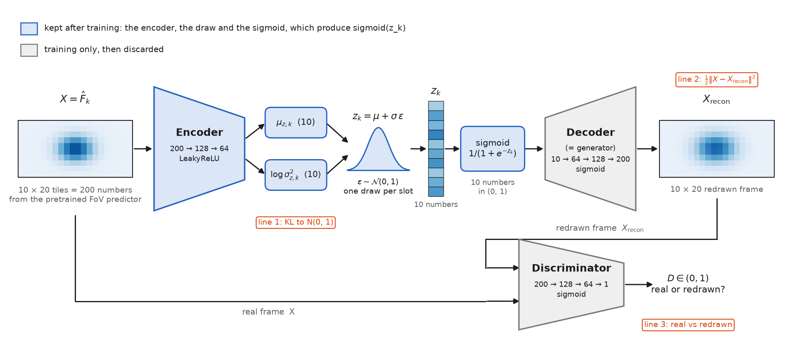
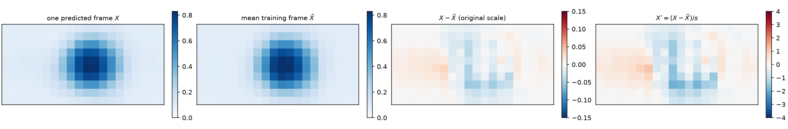
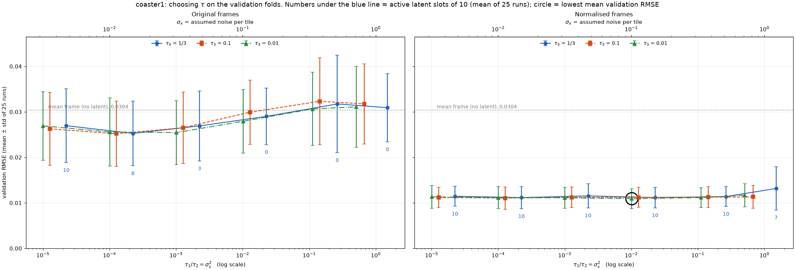
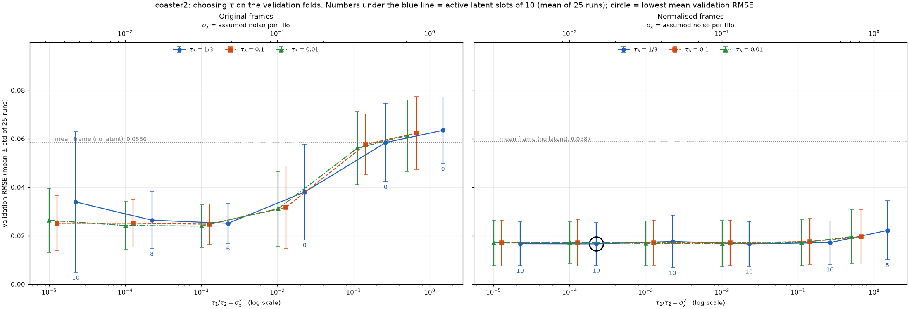
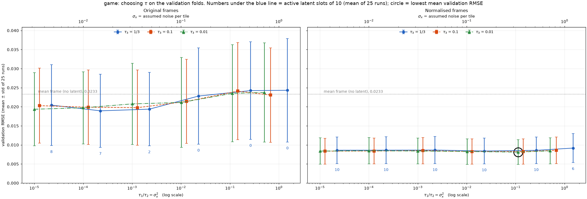
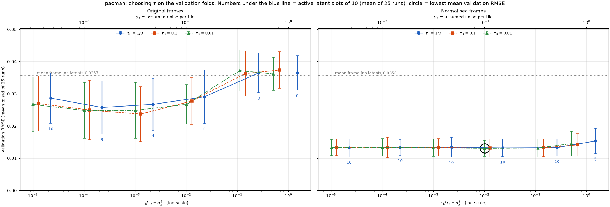
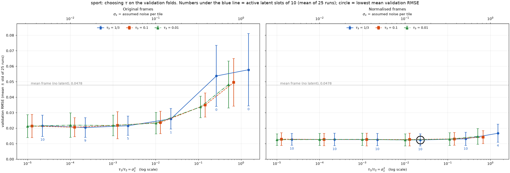

# Field-of-view predictor and CVAE-GAN state compressor for 360° video

Viewers of a 360° video wear a headset and see only part of the picture, their field of view (FoV). If we can predict
where the crowd will look next, we can stream those tiles in high quality and the rest in low quality. This repository
has two models, and both are trained **separately for each of five videos** (coaster1, coaster2, game, pacman, sport):

1. **A FoV predictor** (`predictor/<video>/`) that predicts which tiles of the video will be in view 5 seconds ahead.
2. **A CVAE-GAN** (`vae/<video>/`) that compresses the predicted crowd frame, 200 numbers, into a latent vector $z_k$ of
   **10 numbers**, one per SVC video layer, squashed by a sigmoid so that each number lies between 0 and 1. The
   predictor of the same video is pretrained (its trained weights are loaded and set) and only used to produce the frames.

Viewers look around differently in every video, so a model trained on one video cannot be assumed to work on another.
Every video therefore gets its own predictor, its own loss weights and its own frozen encoder.

## What this repository documents

The CVAE-GAN, its loss and its training are taken from Nie et al. [14] (section 2). The loss has three weights
$\tau_1, \tau_2, \tau_3$ that only have to add up to 1, so their values have to be chosen for the data. On our data
they cannot be set equal: the predicted crowd frames differ from their average by only a few hundredths per tile, and
with equal weights the model learns the average frame and the latent vector carries no information (section 3). This
happens in every one of the five videos.

This repository documents how two settings were chosen, separately for each video:

- **whether the input frames are normalised**, $X' = (X - \bar X)/s$, with $\bar X$ the mean training frame and $s$ the
  typical difference of a tile from it;
- **the loss weights** $\tau_1, \tau_2, \tau_3$.

Both are chosen by nested cross-validation over the viewers of that video (section 4). This is a standard procedure,
not a new method; it is used only so that no setting is chosen on the viewers it is scored on. Sections 3 to 7 give the
reasoning and the full results. The settings found are:

| video | input frames | $\tau_1$ | $\tau_2$ | $\tau_3$ | test RMSE | frozen encoder |
|---|---|---|---|---|---|---|
| coaster1 | normalised | 0.01 | 0.98 | 0.01 | 0.0106 ± 0.0016 | `vae/coaster1/coaster1_frozen_wt.pt` |
| coaster2 | normalised | $10^{-4}$ | 0.6666 | 1/3 | 0.0134 ± 0.0033 | `vae/coaster2/coaster2_frozen_wt.pt` |
| game | normalised | 0.1 | 0.89 | 0.01 | 0.0094 ± 0.0007 | `vae/game/game_frozen_wt.pt` |
| pacman | normalised | 0.01 | 0.98 | 0.01 | 0.0134 ± 0.0040 | `vae/pacman/pacman_frozen_wt.pt` |
| sport | normalised | 0.01 | 0.6567 | 1/3 | 0.0139 ± 0.0026 | `vae/sport/sport_frozen_wt.pt` |

Normalising is chosen for every video. The exact weights differ, but section 6 shows that in every video many weights
reach the same error, so these differences mostly reflect which of several equally good settings won, not a real
difference between the videos.

## Repository layout

```
predictor_vae/
├── dataset/360dataset/sensory/tile/<video>/   input: one <prefix>_<user>_tile.csv per viewer (5 videos × 50 viewers)
├── predictor/
│   ├── make_video_predictors.py        builds and runs one copy of the coaster1 notebook per video
│   ├── cv_predictors.py                held-out RMSE of every predictor (5-fold over viewers), into summary_rmse.csv
│   ├── summary_rmse.csv                the same RMSE values, one row per video
│   ├── fov_videos_summary.md           how the predictors were trained, and their results
│   ├── figures/rmse_by_video.png       RMSE of every per-video predictor
│   └── <video>/                        coaster1, coaster2, game, pacman, sport
│       ├── fov_predictor_<video>.ipynb     trains the FoV predictor of that video and saves its weights
│       ├── predictor_weights_<video>.pt    the pretrained predictor of that video
│       └── figures/
├── vae/
│   ├── make_video_vaes.py              builds and runs the four coaster1 notebooks for every video
│   ├── make_readme_figures.py          draws the figures of this README from the results of every video
│   ├── summary_tau.csv                 the final setting and test RMSE of every video, one row per video
│   └── <video>/                        coaster1, coaster2, game, pacman, sport
│       ├── <video>_vae.ipynb                               the CVAE-GAN explained step by step, one run with equal weights
│       ├── <video>_vae_diff_weights.ipynb                  test 1: different loss weights
│       ├── <video>_vae_normalised_tiles.ipynb              test 2: normalised input frames
│       ├── <video>_vae_normalised_and_diff_weights.ipynb   test 3: normalised frames and different loss weights; final model
│       ├── <video>_frozen_wt.pt                            the final encoder of that video (written by test 3)
│       ├── results/                                        one row per training run, for every test
│       └── figures/
├── images/                             figures used in this README
└── requirements.txt
```

## Setup and run order

```bash
python3 -m venv .venv
source .venv/bin/activate          # Windows: .venv\Scripts\activate
pip install -r requirements.txt
pip install nbformat nbconvert     # only for the two make_*.py scripts
```

Open each notebook with the `.venv` interpreter and run it from its own folder (all paths are relative). For one video,
run the notebooks in this order:

1. `predictor/<video>/fov_predictor_<video>.ipynb`
2. `vae/<video>/<video>_vae_normalised_tiles.ipynb`, then `vae/<video>/<video>_vae_diff_weights.ipynb`, then
   `vae/<video>/<video>_vae_normalised_and_diff_weights.ipynb` (test 3 reads the results of tests 1 and 2)
3. `vae/<video>/<video>_vae.ipynb` (optional: explains the model, and prints the summary of the three tests)

Or build and run everything for all five videos:

```bash
python predictor/make_video_predictors.py --run    # step 1 for every video
python vae/make_video_vaes.py --run                # steps 2 and 3 for every video, and vae/summary_tau.csv
python vae/make_readme_figures.py                  # the figures in images/
```

The coaster1 notebooks are the templates: the two scripts copy them for every other video and change only the video.
On a 12-core CPU, the four CVAE-GAN notebooks of one video take about 45 – 60 minutes.

Every training run of the three experiment notebooks is saved in `vae/<video>/results/`. When a notebook is opened again
it loads these results instead of training again, unless `RERUN = True` is set in its first code cell.

## 1. The FoV predictors

For each viewer, the tile CSV is turned into a 10 × 20 map (rows = latitude, columns = longitude) with a 1 on every tile
in the viewer's field of view, sampled once every 5 s. A small convolutional network with 3,073 weights takes the last
five maps and predicts the next one, as a probability for each tile. Every video has its own predictor: the same
network, trained only on that video's 50 viewers with Adam on binary cross-entropy, and saved as a **pretrained
predictor** for use by that video's CVAE-GAN.

The CVAE-GAN takes the **crowd frame**, the average of 10 viewers, so the error that matters is the crowd RMSE. Scored on
viewers the predictor never saw (5-fold cross-validation over viewers, `predictor/cv_predictors.py`):

| held-out RMSE (lower is better) | coaster1 | coaster2 | game | pacman | sport |
|---|---|---|---|---|---|
| FoV predictor, 10-viewer crowd | **0.0997** | **0.1030** | **0.0970** | **0.1215** | **0.1224** |
| repeat the last map, 10-viewer crowd | 0.1207 | 0.1150 | 0.1153 | 0.1567 | 0.1879 |
| FoV predictor, single viewer | 0.2546 | 0.2554 | 0.2552 | 0.2310 | 0.2418 |

How the predictors were trained and why, and the figures of each video, are in `predictor/fov_videos_summary.md`.

## 2. What the CVAE-GAN compresses

The predictor is fed the **crowd frame**: the average of the FoV maps of a group of 10 viewers. Its output
$\hat F_k$ is a 10 × 20 grid saying, for each tile, what share of the crowd is expected to look at it. This is the input
$X$ of the CVAE-GAN. One epoch draws a new group of 10 viewers and gives 7 predicted frames ($k = 6, \dots, 12$);
training runs for 988 epochs.

The CVAE-GAN, its loss and its training are taken from:

> [14] X. Nie, C. Wang, T. Zhou, Q. Zhou, X. Zhu, J. Zhang, "Mobility-Aware Cooperative Caching in IoVs Based on Secure
> Asynchronous Federated and Deep Reinforcement Learning," *IEEE Internet of Things Journal*, vol. 12, no. 12, 2025.

Our frames come with no per-user features, so the decoder has no conditioning input.

An **encoder** turns a frame into a mean $\mu_{z,k}$ and a spread $\sigma_{z,k}$ for each of 10 latent slots, and the
latent vector is drawn as $z_k = \mu_{z,k} + \sigma_{z,k}\,\varepsilon$ with $\varepsilon \sim \mathcal N(0, 1)$. A **sigmoid**
then squashes it into (0, 1): the 10 numbers that stand for the frame are $\mathrm{sigmoid}(z_k) = 1/(1 + e^{-z_k})$. A
**decoder** redraws the frame from $\mathrm{sigmoid}(z_k)$ alone, so the reconstruction error measures what survives the
squashing, and a **discriminator** judges whether a frame is real or redrawn. Training minimises the loss of [14]
(line 1 is computed on $z_k$ before the sigmoid):

$$\mathcal L = \tau_1\,\underbrace{\mathrm{KL}\big(\mathcal N(\mu_{z,k}, \sigma^2_{z,k})\,\Vert\,\mathcal N(0, 1)\big)}_{\text{line 1}}
\;+\; \tau_2\,\underbrace{\tfrac12\lVert X - X_\mathrm{recon}\rVert^2}_{\text{line 2}}
\;+\; \tau_3\,\underbrace{\big(\mathbb E\log D(X) + \mathbb E\log(1 - D(X_\mathrm{recon}))\big)}_{\text{line 3}},
\qquad \tau_1 + \tau_2 + \tau_3 = 1.$$

Only the sum of the weights is fixed, so `<video>_vae.ipynb` starts from equal weights, $\tau_1 = \tau_2 = \tau_3 = \tfrac13$.



## 3. The problem: with equal weights the CVAE-GAN learns the average

With equal weights, training converges, but the result is of no use. Every latent slot ends at $\mu_{z,k} \approx 0$ and
$\sigma_{z,k} \approx 1$ **whatever frame is given**, so $z_k$ is 10 random numbers that say nothing about the frame.
The decoder, which cannot use $z_k$, learns the best single frame it can draw: the average frame. Its reconstruction
error is no better than always answering the average frame. This is the same in every video:

| test folds, 25 runs per video (section 4) | coaster1 | coaster2 | game | pacman | sport |
|---|---|---|---|---|---|
| always redraw the average frame (no latent) | 0.0301 | 0.0538 | 0.0291 | 0.0354 | 0.0532 |
| CVAE-GAN, equal weights | 0.0314 ± 0.0078 | 0.0636 ± 0.0206 | 0.0301 ± 0.0067 | 0.0370 ± 0.0039 | 0.0623 ± 0.0187 |
| latent slots in use (of 10) | **0** in every run | **0** in every run | **0** in every run | **0** in every run | **0** in every run |

(RMSE: the reconstruction error per tile on the 0–1 tile scale, mean ± standard deviation over the runs.)

### Why it happens

Line 1 of the loss (the KL divergence) is a **charge for information**: a latent slot is only allowed to move away from
$\mathcal N(0, 1)$ if that pays for itself. Line 2 pays for information only through the reconstruction error it
removes. Lines 1 and 2 together are the loss of a standard VAE whose decoder assumes Gaussian noise on every tile:

$$\tfrac{1}{2\sigma_x^2}\lVert X - X_\mathrm{recon}\rVert^2 + \mathrm{KL}
\;\;\Longleftrightarrow\;\;
\tau_2\,\tfrac12\lVert X - X_\mathrm{recon}\rVert^2 + \tau_1\,\mathrm{KL}
\qquad\text{with}\qquad \boxed{\;\frac{\tau_1}{\tau_2} = \sigma_x^2\;}$$

So the ratio $\tau_1/\tau_2$ is the **noise level per tile the model believes in**. With equal weights it is
$\sigma_x = 1$: the model assumes every tile is only accurate to about ±1.

The predicted crowd frames differ from their average by only **0.03 – 0.05** per tile (the first row of the table
above: about 0.03 for coaster1, game and pacman, about 0.05 for coaster2 and sport). They are an average of 10 viewers
passed through a predictor, so they are all nearly the same smooth blob. Next to an assumed noise of 1, a difference of a
few hundredths is indistinguishable from noise, and encoding it costs tens of nats on line 1 while saving at most a few
tenths on line 2. Encoding nothing is the cheapest solution, so every slot collapses to $\mathcal N(0, 1)$ and the
decoder redraws the average. Equal weights therefore cannot be used on these frames as they are.

For a linear encoder and decoder this is exact: a latent slot is used along a principal direction of the data only if
the variance of the data along it is larger than $\tau_1/\tau_2$. The networks here are nonlinear, so this shows what
to expect, and the experiments below check it.

## 4. How the settings are compared

Every setting is trained and scored in exactly the same way, and the choice of the best setting never sees the data it
is finally scored on. This is standard nested cross-validation with the viewers as groups; it is not a new method. It
is done for each video on its own, with that video's 50 viewers.

- **Viewer folds.** The 50 viewers are split into 5 folds of 10 (viewer number $i$ goes to fold $i \bmod 5$). Each fold
  takes one turn as the **test fold**, so every viewer is tested exactly once.
- **Validation inside the training viewers.** In each turn the next fold is the **validation fold** and the other 30
  viewers are the training viewers. Settings are compared on the validation fold only; the chosen setting is then
  trained on all 40 non-test viewers and scored once on the test fold.
- **A predictor for every turn.** The FoV predictor is retrained in every turn on the training viewers only, so the
  frames of validation and test viewers come from a predictor that has never seen those viewers. These fold predictors
  use the predictor's first training procedure (494 plain gradient-descent steps on the squared error); the saved
  predictors of section 1 were later retrained with Adam, and only the final model of each video uses them (section 7).
- **Repeats.** Every setting is trained 5 times in every turn from fresh random starting weights and fresh random groups
  of viewers. No random seed is fixed; the seed each run used is saved with its result.
- **The rule, fixed before any run.** In each turn, the setting with the lowest validation RMSE (mean of its 5 repeats)
  is chosen and tested. The final setting is the one with the lowest validation RMSE over all its 25 runs.
- **The same yardstick everywhere.** Every run also records the error of always answering the mean training frame on
  the same frames. A latent vector that carries information about the frame must do better than that.

The normalisation statistics $\bar X$ and $s$ and the mean-frame yardstick are computed from the training frames of each
run only. The three test notebooks of a video score on the same test frames (their mean-frame errors agree to within
0.0005 per fold), so their results can be compared directly.

## 5. The three tests

All three use the same data, networks and training as `<video>_vae.ipynb`, so any change in the result comes from the
change being tested. Both fixes follow from the identity in section 3: make the loss believe in smaller noise (change
$\tau$), or make the differences between frames larger (normalise). Each test is run once per video.

### Test 1: different loss weights, `<video>_vae_diff_weights.ipynb`

Lowers the weight $\tau_1$ of the KL charge step by step, so that the assumed noise $\sigma_x = \sqrt{\tau_1/\tau_2}$ drops
below the real differences between tiles. 18 settings, fixed in advance:
$\tau_1 \in \{\tfrac13, 10^{-1}, 10^{-2}, 10^{-3}, 10^{-4}, 10^{-5}\}$, $\tau_3 \in \{\tfrac13, 0.1, 0.01\}$ and
$\tau_2 = 1 - \tau_1 - \tau_3$, each trained 25 times on the validation folds of every video.

| original frames, test folds | coaster1 | coaster2 | game | pacman | sport |
|---|---|---|---|---|---|
| average frame | 0.0301 | 0.0538 | 0.0291 | 0.0354 | 0.0532 |
| equal weights | 0.0314 ± 0.0078 | 0.0636 ± 0.0206 | 0.0301 ± 0.0067 | 0.0370 ± 0.0039 | 0.0623 ± 0.0187 |
| **weights chosen on validation** | **0.0253 ± 0.0058** | **0.0229 ± 0.0057** | **0.0255 ± 0.0048** | **0.0264 ± 0.0061** | **0.0212 ± 0.0065** |
| slots in use with chosen weights | 8.2 | 9.6 | 7.9 | 5.8 | 10.0 |

**Result:** lowering $\tau_1$ removes the collapse in every video. Almost no slot is used at $\tau_1 \ge 10^{-2}$ (at most
1.2 of 10), 2 – 7 at $10^{-3}$, and 7 – 10 at $10^{-4}$ and below. The chosen weights beat equal weights in all 5 turns
of every video. How much they gain depends on how much the frames differ: on coaster1, game and pacman (frames differ by
about 0.03) the error stays close to the average frame (12 – 25 % below it); on coaster2 and sport (about 0.05) it falls
to less than half of it.

### Test 2: normalised input frames, `<video>_vae_normalised_tiles.ipynb`

Keeps the equal weights and changes the data instead: the frames are normalised, $X' = (X - \bar X)/s$, where $\bar X$ is
the mean training frame and $s$ is the error of always answering $\bar X$ (0.03 – 0.05), both computed from the training
frames of each run. A tile then differs from its average by about 1 instead of a few hundredths, which is the scale at
which equal weights work. The decoder output is linear (no sigmoid), and the RMSE is converted back to the 0–1 scale.
Since nothing is chosen here, the two fixed models (original and normalised frames) are scored directly on the test
folds.

| equal weights, test folds | coaster1 | coaster2 | game | pacman | sport |
|---|---|---|---|---|---|
| average frame | 0.0301 | 0.0538 | 0.0291 | 0.0354 | 0.0532 |
| original frames | 0.0314 ± 0.0078 | 0.0636 ± 0.0206 | 0.0301 ± 0.0067 | 0.0370 ± 0.0039 | 0.0623 ± 0.0187 |
| **normalised frames** | **0.0107 ± 0.0021** | **0.0187 ± 0.0052** | **0.0102 ± 0.0008** | **0.0157 ± 0.0066** | **0.0174 ± 0.0035** |
| slots in use, normalised frames | 6.5 | 5.3 | 6.9 | 4.9 | 4.5 |

**Result:** normalising lowers the test RMSE in all 5 turns of every video, to 2.2 – 3.1 times below the average frame.
With equal weights only about half to two thirds of the 10 slots are used.



One test frame of coaster1. From left to right: the predicted frame, the mean training frame, their difference (a few
hundredths per tile), and the same difference divided by $s$ (about 1 per tile): same shape, about 30 times larger. The
notebooks of every video also show the full 20 × 10 grid of tile values before and after.

### Test 3: normalised frames and different weights, `<video>_vae_normalised_and_diff_weights.ipynb`

Combines both: normalised frames and the same 18 settings of $\tau$, with the same folds, repeats and rule. It then applies
the rule to all 36 settings at once (original or normalised frames × 18 weights) and trains the final model.

| normalised frames, test folds | coaster1 | coaster2 | game | pacman | sport |
|---|---|---|---|---|---|
| equal weights | 0.0107 ± 0.0021 | 0.0187 ± 0.0052 | 0.0102 ± 0.0008 | 0.0157 ± 0.0066 | 0.0174 ± 0.0035 |
| **weights chosen on validation** | **0.0106 ± 0.0016** | **0.0134 ± 0.0033** | **0.0094 ± 0.0007** | **0.0134 ± 0.0040** | **0.0139 ± 0.0026** |
| slots in use with chosen weights | 9.9 | 10.0 | 10.0 | 9.9 | 10.0 |
| turns in which chosen weights beat equal weights | 2 of 5 | 5 of 5 | 5 of 5 | 5 of 5 | 5 of 5 |

**Result:** on normalised frames every setting is far below the average frame, and in every video equal weights are the
worst of the 18. With $\tau_1 \le 0.1$ about all 10 slots are used. Choosing the weights lowers the error in all 5 turns
of four videos (by 8 – 28 %); on coaster1 the two are equal (0.0107 and 0.0106). When the rule also chooses between
original and normalised frames, it picks normalised frames in all 5 turns of every video.

## 6. How the weights were chosen











Validation RMSE (mean ± standard deviation of 25 runs) against τ₁/τ₂ = σₓ² (top axis: σₓ) for all 18 settings, on
the original frames (left, test 1) and the normalised frames (right, test 3), one figure per video. The numbers under the
blue line are the active latent slots; the circle is the lowest mean validation RMSE over both panels.

- **On the original frames** the tiles differ by 0.03 – 0.05, so the threshold is $\sigma_x^2 \approx 10^{-3}$. To the
  right of it the latent collapses (almost no slot at $\tau_1/\tau_2 \ge 10^{-2}$); at and below it the slots come into
  use. Equal weights ($\sigma_x = 1$) are 17 – 43 times above the spread.
- **On the normalised frames** the spread is 1, so equal weights sit at the threshold, which is why only about half to
  two thirds of the slots are used there. From $\tau_1 = 0.1$ ($\sigma_x \approx 0.3$) down, about all 10 are used. Going
  below $\tau_1 = 0.01$ does not lower the error further: the KL charge rises (to 44 – 62 nats) while the error stays
  within 0.0005 of its value at $\tau_1 = 0.01$, because the sigmoid squashes values of $z_k$ far from 0 to almost 0 or 1,
  so extra precision in $z_k$ can hardly be used. (coaster2's final $\tau_1 = 10^{-4}$ is one of these ties.)
- **The discriminator's weight** $\tau_3$ matters only where the latent collapses (equal weights on original frames). On
  normalised frames it changes the validation error by at most 0.003, less than the differences between runs.

By the rule fixed in advance, the setting with the lowest validation RMSE over all 36 settings is:

| video | input frames | $\tau_1$ | $\tau_2$ | $\tau_3$ | validation RMSE | next-best setting |
|---|---|---|---|---|---|---|
| coaster1 | normalised | 0.01 | 0.98 | 0.01 | 0.0109 ± 0.0022 | + 0.0001 |
| coaster2 | normalised | $10^{-4}$ | 0.6666 | 1/3 | 0.0166 ± 0.0088 | + 0.0000 |
| game | normalised | 0.1 | 0.89 | 0.01 | 0.0081 ± 0.0033 | + 0.0001 |
| pacman | normalised | 0.01 | 0.98 | 0.01 | 0.0131 ± 0.0025 | + 0.0001 |
| sport | normalised | 0.01 | 0.6567 | 1/3 | 0.0124 ± 0.0039 | + 0.0000 |

**How firm these choices are.** In every video the next-best setting is within 0.0001 of the winner, far less than the
differences between runs (the ± column, 0.002 – 0.009). So the rule picks normalised frames with certainty, and
$\tau_1 \le 0.1$ with certainty, but which of the good settings wins is close to chance. The different weights of the
five videos should be read this way. The validation RMSE of the winner is also slightly optimistic, because it is the
lowest of 36; the test RMSE of section 7 has no such bias, since the test folds play no part in the choice.

## 7. Conclusion: why normalised frames and these weights


Test RMSE of the four ways of setting up the model, every video side by side (25 runs per bar; the numbers are the RMSE
and the active slots of 10; dotted line: always the average frame).

| test folds, 25 runs each | coaster1 | coaster2 | game | pacman | sport |
|---|---|---|---|---|---|
| always redraw the average frame (no latent) | 0.0301 | 0.0538 | 0.0291 | 0.0354 | 0.0532 |
| original frames, equal weights | 0.0314 ± 0.0078 | 0.0636 ± 0.0206 | 0.0301 ± 0.0067 | 0.0370 ± 0.0039 | 0.0623 ± 0.0187 |
| original frames, weights chosen on validation | 0.0253 ± 0.0058 | 0.0229 ± 0.0057 | 0.0255 ± 0.0048 | 0.0264 ± 0.0061 | 0.0212 ± 0.0065 |
| normalised frames, equal weights | 0.0107 ± 0.0021 | 0.0187 ± 0.0052 | 0.0102 ± 0.0008 | 0.0157 ± 0.0066 | 0.0174 ± 0.0035 |
| **normalised frames, weights chosen on validation** | **0.0106 ± 0.0016** | **0.0134 ± 0.0033** | **0.0094 ± 0.0007** | **0.0134 ± 0.0040** | **0.0139 ± 0.0026** |

1. **Equal weights collapse** on the original frames in every video: no slot is used in any of the 125 runs, and the
   error is no better than the average frame, because the loss assumes noise of size 1 on tiles that differ by a few
   hundredths.
2. **Changing only the weights removes the collapse**, but how far it lowers the error depends on the video: a little on
   coaster1, game and pacman, by more than half on coaster2 and sport.
3. **Normalising the frames is what lowers the error most**, to 2.2 – 3.1 times below the average frame with equal
   weights, in every turn of every video.
4. **On normalised frames, choosing the weights helps a little more** in four of the five videos, and brings about all 10
   slots into use in every video, where equal weights leave several unused. The final error is 2.6 – 4.0 times below the
   average frame, and below it in every turn of every video.

**Final settings:** for each video, the setting in the table of section 6, chosen on validation data by a rule fixed before
any training, and confirmed on test viewers that the choice never saw. Each video's final encoder,
`vae/<video>/<video>_frozen_wt.pt` (written by test 3), is trained with that setting on all 50 viewers of the video and with
the video's saved predictor. It stores the normalisation statistics with the weights, so together with the sigmoid it turns
a predicted frame of that video directly into the 10 numbers $\mathrm{sigmoid}(z_k)$, each between 0 and 1. In every video
all 10 slots of the frozen encoder are in use.

The saved predictors (section 1) produce frames that differ from their average more than those of the fold predictors
($s$ = 0.038 – 0.082 instead of 0.03 – 0.05), so the training error printed for each final encoder (0.016 – 0.026) is
higher than the test RMSE above and not directly comparable to it. To make the two match, the fold predictors would have
to be retrained with the same procedure as the saved predictors, and the three tests run again.
