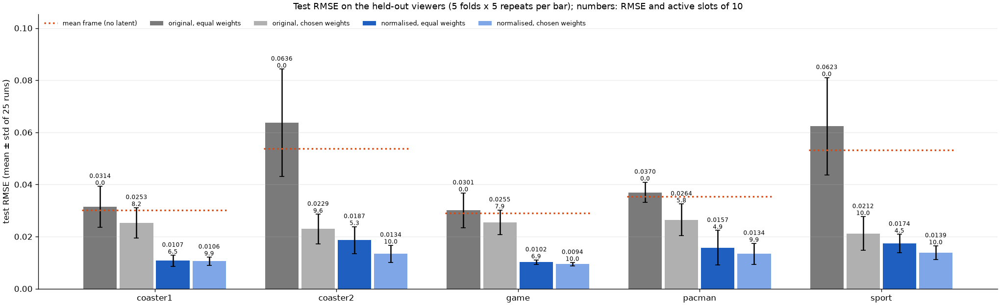

# Field-of-view predictor and CVAE-GAN state compressor for 360° video

Viewers of a 360° video wear a headset and see only part of the picture, their field of view (FoV). If we can predict
where the crowd will look next, we can stream those tiles in high quality and the rest in low quality. This repository
has two models:

1. **A FoV predictor** (`predictor/`) that predicts which tiles of the video will be in view 5 seconds ahead.
2. **A CVAE-GAN** (`vae/`) that compresses the predicted crowd frame, 200 numbers, into a latent vector $z_k$ of
   **10 numbers**, one per SVC video layer, squashed by a sigmoid so that each number lies between 0 and 1. The predictor is pretrained (its trained weights are loaded and set) and only used to produce the frames.

## What this repository documents

The CVAE-GAN, its loss and its training are taken from Nie et al. [14] (section 2). The loss has three weights
$\tau_1, \tau_2, \tau_3$ that only have to add up to 1, so their values have to be chosen for the data. On our data
they cannot be set equal: the predicted crowd frames differ from their average by only about 0.03 per tile, and with
equal weights the model learns the average frame and the latent vector carries no information (section 3).

This repository documents how two settings were chosen for our data:

- **the input frames are normalised**, $X' = (X - \bar X)/s$, with $\bar X$ the mean training frame and $s \approx 0.03$;
- **the loss weights are set** to $\tau_1 = 0.1$, $\tau_2 = 0.89$, $\tau_3 = 0.01$.

Both are chosen by nested cross-validation over the viewers (section 4). This is a standard procedure, not a new
method; it is used only so that no setting is chosen on the viewers it is scored on. Sections 3 to 7 give the
reasoning and the full results.

## Repository layout

```
predictor_vae/
├── dataset/360dataset/sensory/tile/<video>/   input: one <prefix>_<user>_tile.csv per viewer (10 videos × 50 viewers)
├── predictor/
│   ├── make_video_predictors.py        builds and runs one copy of the coaster1 notebook per video
│   ├── fov_videos_summary.md           RMSE of every per-video predictor and how they were trained
│   ├── summary_rmse.csv                the same RMSE values, one row per video
│   ├── <video>/                        coaster1, coaster2, diving, drive, game, landscape, pacman, panel, ride, sport
│   │   ├── fov_predictor_<video>.ipynb     trains the FoV predictor of that video and saves its weights
│   │   ├── predictor_weights_<video>.pt    the frozen predictor of that video
│   │   └── figures/
│   └── figures/rmse_by_video.png       RMSE of every per-video predictor
├── vae/
│   ├── cvae_gan.ipynb                              the CVAE-GAN explained step by step, one run with equal weights
│   ├── cvae_gan_diff_weights.ipynb                 test 1: different loss weights
│   ├── cvae_gan_normalised_tiles.ipynb             test 2: normalised input frames
│   ├── cvae_gan_normalised_and_diff_weights.ipynb  test 3: normalised frames and different loss weights; final model
│   ├── cvaegan_encoder.pt                          the final encoder (written by test 3)
│   ├── results/                                    one row per training run, for every test
│   └── figures/
├── images/                             figures used in this README
└── requirements.txt
```

## Setup and run order

```bash
python3 -m venv .venv
source .venv/bin/activate
pip install -r requirements.txt
```

Open each notebook with the `.venv` interpreter and run it from its own folder (all paths are relative). Run the
notebooks in this order:

1. `predictor/coaster1/fov_predictor_coaster1.ipynb` (the predictor used by `vae/`). To train a frozen predictor for every video, run
   `python predictor/make_video_predictors.py --run` instead; see `predictor/fov_videos_summary.md`.
2. `vae/cvae_gan.ipynb` (optional: explains the model)
3. `vae/cvae_gan_diff_weights.ipynb`, then `vae/cvae_gan_normalised_tiles.ipynb`, then
   `vae/cvae_gan_normalised_and_diff_weights.ipynb`

Every training run of the three experiment notebooks is saved in `vae/results/`. When a notebook is opened again it loads
these results instead of training again, unless `RERUN = True` is set in its first code cell.

## 1. The FoV predictor

For each viewer, the tile CSV is turned into a 10 × 20 map (rows = latitude, columns = longitude) with a 1 on every tile
in the viewer's field of view, sampled once every 5 s. A small convolutional network with 3,073 weights takes the last
five maps and predicts the next one, as a probability for each tile. The predictor is trained for 494 epochs, each on a
random group of 10 of the 50 viewers, and its trained weights are saved as a **pretrained predictor** for use by the CVAE-GAN.

| test RMSE (lower is better) | all 50 viewers | held-out group |
|---|---|---|
| FoV predictor | 0.2729 | 0.2601 |
| repeat the last map | 0.3183 | 0.3030 |
| average tile occupancy | 0.3716 | 0.3689 |

## 2. What the CVAE-GAN compresses

The predictor is fed the **crowd frame**: the average of the FoV maps of a group of 10 viewers. Its output
$\hat F_k$ is a 10 × 20 grid saying, for each tile, what share of the crowd is expected to look at it. This is the input
$X$ of the CVAE-GAN. One epoch draws a new group of 10 viewers and gives 7 predicted frames ($k = 6, \dots, 12$);
training runs for 988 epochs.

The CVAE-GAN, its loss and its training are taken from:

> [14] X. Nie, C. Wang, T. Zhou, Q. Zhou, X. Zhu, J. Zhang, "Mobility-Aware Cooperative Caching in IoVs Based on Secure
> Asynchronous Federated and Deep Reinforcement Learning," *IEEE Internet of Things Journal*, vol. 12, no. 12, 2025.

Our frames come with no per-user features, so the decoder has no conditioning input.

An **encoder** turns a frame into a mean $\mu_{z,k}$ and a spread $\sigma_{z,k}$ for each of 10 latent slots, and the
latent vector is drawn as $z_k = \mu_{z,k} + \sigma_{z,k}\,\varepsilon$ with $\varepsilon \sim \mathcal N(0, 1)$. A **sigmoid**
then squashes it into (0, 1): the 10 numbers that stand for the frame are $\mathrm{sigmoid}(z_k) = 1/(1 + e^{-z_k})$. A
**decoder** redraws the frame from $\mathrm{sigmoid}(z_k)$ alone, so the reconstruction error measures what survives the
squashing, and a **discriminator** judges whether a frame is real or redrawn. Training minimises the loss of [14]
(line 1 is computed on $z_k$ before the sigmoid):

$$\mathcal L = \tau_1\,\underbrace{\mathrm{KL}\big(\mathcal N(\mu_{z,k}, \sigma^2_{z,k})\,\Vert\,\mathcal N(0, 1)\big)}_{\text{line 1}}
\;+\; \tau_2\,\underbrace{\tfrac12\lVert X - X_\mathrm{recon}\rVert^2}_{\text{line 2}}
\;+\; \tau_3\,\underbrace{\big(\mathbb E\log D(X) + \mathbb E\log(1 - D(X_\mathrm{recon}))\big)}_{\text{line 3}},
\qquad \tau_1 + \tau_2 + \tau_3 = 1.$$

Only the sum of the weights is fixed, so `cvae_gan.ipynb` starts from equal weights, $\tau_1 = \tau_2 = \tau_3 = \tfrac13$.


## 3. The problem: with equal weights the CVAE-GAN learns the average

With equal weights, training converges, but the result is of no use. Every latent slot ends at $\mu_{z,k} \approx 0$ and
$\sigma_{z,k} \approx 1$ **whatever frame is given**, so $z_k$ is 10 random numbers that say nothing about the frame.
The decoder, which cannot use $z_k$, learns the best single frame it can draw: the average frame. Its reconstruction
error is the same as always answering the average frame.

| test folds, 25 runs (section 4) | test RMSE | latent slots in use (of 10) |
|---|---|---|
| always redraw the average frame (no latent) | 0.0301 | – |
| CVAE-GAN, equal weights | 0.0304 ± 0.0067 | **0** in every run |

(RMSE: the reconstruction error per tile on the 0–1 tile scale, mean ± standard deviation over the runs.)

### Why it happens

Line 1 of the loss (the KL divergence) is a **charge for information**: a latent slot is only allowed to move away from
$\mathcal N(0, 1)$ if that pays for itself. Line 2 pays for information only through the reconstruction error it
removes. Lines 1 and 2 together are the loss of a standard VAE whose decoder assumes Gaussian noise on every tile:

$$\tfrac{1}{2\sigma_x^2}\lVert X - X_\mathrm{recon}\rVert^2 + \mathrm{KL}
\;\;\Longleftrightarrow\;\;
\tau_2\,\tfrac12\lVert X - X_\mathrm{recon}\rVert^2 + \tau_1\,\mathrm{KL}
\qquad\text{with}\qquad \boxed{\;\frac{\tau_1}{\tau_2} = \sigma_x^2\;}$$

So the ratio $\tau_1/\tau_2$ is the **noise level per tile the model believes in**. With equal weights it is
$\sigma_x = 1$: the model assumes every tile is only accurate to about ±1.

The predicted crowd frames differ from their average by only about **±0.03** per tile. They are an average of 10 viewers
passed through a predictor, so they are all nearly the same smooth blob. Next to an assumed noise of 1, a difference of
0.03 is indistinguishable from noise, and encoding it costs tens of nats on line 1 while saving at most about 0.1 on
line 2. Encoding nothing is the cheapest solution, so every slot collapses to $\mathcal N(0, 1)$ and the decoder redraws
the average. Equal weights therefore cannot be used on these frames as they are.

For a linear encoder and decoder this is exact: a latent slot is used along a principal direction of the data only if
the variance of the data along it is larger than $\tau_1/\tau_2$. The networks here are nonlinear, so this shows what
to expect, and the experiments below check it.

## 4. How the settings are compared

Every setting is trained and scored in exactly the same way, and the choice of the best setting never sees the data it
is finally scored on. This is standard nested cross-validation with the viewers as groups; it is not a new method.

- **Viewer folds.** The 50 viewers are split into 5 folds of 10 (viewer number $i$ goes to fold $i \bmod 5$). Each fold
  takes one turn as the **test fold**, so every viewer is tested exactly once.
- **Validation inside the training viewers.** In each turn the next fold is the **validation fold** and the other 30
  viewers are the training viewers. Settings are compared on the validation fold only; the chosen setting is then
  trained on all 40 non-test viewers and scored once on the test fold.
- **A predictor for every turn.** The FoV predictor is retrained in every turn on the training viewers only, so the
  frames of validation and test viewers come from a predictor that has never seen those viewers.
- **Repeats.** Every setting is trained 5 times in every turn from fresh random starting weights and fresh random groups
  of viewers. No random seed is fixed; the seed each run used is saved with its result.
- **The rule, fixed before any run.** In each turn, the setting with the lowest validation RMSE (mean of its 5 repeats)
  is chosen and tested. The final setting is the one with the lowest validation RMSE over all its 25 runs.
- **The same yardstick everywhere.** Every run also records the error of always answering the mean training frame on
  the same frames. A latent vector that carries information about the frame must do better than that.

## 5. The three tests

All three use the same data, networks and training as `vae/cvae_gan.ipynb`, so any change in the result comes from the
change being tested. Both fixes follow from the identity in section 3: make the loss believe in smaller noise (change
$\tau$), or make the differences between frames larger (normalise).

### Test 1: different loss weights, `vae/cvae_gan_diff_weights.ipynb`

Lowers the weight $\tau_1$ of the KL charge step by step, so that the assumed noise $\sigma_x = \sqrt{\tau_1/\tau_2}$ drops
below the real differences between tiles. 18 settings, fixed in advance:
$\tau_1 \in \{\tfrac13, 10^{-1}, 10^{-2}, 10^{-3}, 10^{-4}, 10^{-5}\}$, $\tau_3 \in \{\tfrac13, 0.1, 0.01\}$ and
$\tau_2 = 1 - \tau_1 - \tau_3$, each trained 25 times on the validation folds.

**Result:** lowering $\tau_1$ removes the collapse (2 – 4 slots in use at $\tau_1/\tau_2 \approx 10^{-3}$, 8 – 10 at $10^{-4}$
and below), but the error improves only a little. Weights chosen on validation give a test RMSE of **0.0254 ± 0.0061**,
better than equal weights in all 5 turns, yet still close to the average frame (0.0301).

### Test 2: normalised input frames, `vae/cvae_gan_normalised_tiles.ipynb`

Keeps the equal weights and changes the data instead: the frames are normalised, $X' = (X - \bar X)/s$, where $\bar X$ is
the mean training frame and $s$ is the error of always answering $\bar X$ ($s \approx 0.03$), both computed from the training
frames of each run. A tile then differs from its average by about 1 instead of 0.03, which is the scale at which equal
weights work. The decoder output is linear (no sigmoid), and the RMSE is converted back to the 0–1 scale. Since nothing
is chosen here, the two fixed models (original and normalised frames) are scored directly on the test folds.

**Result:** the test RMSE falls from 0.0304 ± 0.0067 to **0.0110 ± 0.0021**, lower in all 5 turns and about 2.7 times
below the average frame. With equal weights about 7 of the 10 slots are used.


One row of 20 tiles of a test frame. (a) The frame is almost the mean frame. (b) Before normalising, their difference is
about 0.03 per tile. (c) After dividing by s, the same differences are about 1: same shape, 33 times larger. The
notebooks also show the full 20 × 10 grid of tile values before and after.


The same frame as a whole 10 × 20 grid, in miniature. Before, the frame is one smooth blob; after, the small differences from the mean frame are what is shown (colour scales differ: 0–1 before, around 0 after).

### Test 3: normalised frames and different weights, `vae/cvae_gan_normalised_and_diff_weights.ipynb`

Combines both: normalised frames and the same 18 settings of $\tau$, with the same folds, repeats and rule. It then applies
the rule to all 36 settings at once (original or normalised frames × 18 weights) and trains the final model.

**Result:** on normalised frames every setting reaches 0.0110 – 0.0124 on validation, against 0.0304 for the average
frame. Equal weights are the worst of them and use about 7 slots; with $\tau_1 \le 0.1$ about all 10 are used. Weights
chosen on validation give a test RMSE of **0.0101 ± 0.0016** with all 10 slots in use, better than equal weights in all 5
turns. When the rule also chooses between original and normalised frames, it picks normalised frames in all 5 turns.

## 6. How the weights were chosen


Validation RMSE (mean ± standard deviation of 25 runs) against τ₁/τ₂ = σₓ² (top axis: σₓ) for all 18 settings, on
the original frames (left, test 1) and the normalised frames (right, test 3). The dashed line marks σₓ² equal to the
spread of the tiles squared, the point below which the differences between frames stop looking like noise to the loss.
The numbers under the blue line are the active latent slots; the circle is the lowest mean validation RMSE.

- **On the original frames** the spread is about 0.03, so the threshold is $\sigma_x^2 \approx 9 \times 10^{-4}$. To the right of it
  the latent collapses (no slot at $\tau_1/\tau_2 \ge 0.1$, under one at $10^{-2}$); at and below it the slots come into
  use. Equal weights ($\sigma_x = 1$) are 33 times above the spread.
- **On the normalised frames** the spread is 1, so equal weights sit at the threshold, which is why only about 7 slots are
  used there. At $\tau_1 = 0.1$ ($\sigma_x \approx 0.3$) about all 10 are used and the validation error is lowest. Going
  lower does not help: below $\tau_1 = 0.01$ the KL charge rises (about 39 → 47 nats) and the error gets slightly worse,
  because the sigmoid squashes values of $z_k$ far from 0 to almost 0 or 1, so extra precision in $z_k$ can hardly be used.
- **The discriminator's weight** $\tau_3$ makes almost no difference in either case.

By the rule fixed in advance, the setting with the lowest validation RMSE over all 36 settings is **normalised frames** with
$\tau_1 = 0.1$, $\tau_2 = 0.89$, $\tau_3 = 0.01$ (0.0110 ± 0.0023). The settings with $\tau_1 = 0.01$ are within 0.0001 of it.

## 7. Conclusion: why normalised frames and these weights



| how the model is set up (test folds, 25 runs each) | test RMSE | active slots (of 10) |
|---|---|---|
| always redraw the average frame (no latent) | 0.0301 | – |
| original frames, equal weights | 0.0304 ± 0.0067 | 0.0 |
| original frames, weights chosen on validation | 0.0254 ± 0.0061 | 9.1 |
| normalised frames, equal weights | 0.0110 ± 0.0021 | 6.9 |
| **normalised frames, weights chosen on validation** | **0.0101 ± 0.0016** | **10.0** |

1. **Equal weights collapse** on the original frames: no slot is used in any run, and the error is no better than the
   average frame, because the loss assumes noise of size 1 on tiles that differ by about 0.03.
2. **Changing only the weights removes the collapse but barely improves the error** (0.0254, against 0.0301 for the
   average frame).
3. **Normalising the frames is what lowers the error most**, by about 2.7 times, in every one of the 5 turns.
4. **On normalised frames, choosing the weights helps a little more**: the error drops from 0.0110 to 0.0101 (lower in all
   5 turns) and all 10 slots carry information, where equal weights leave about 3 of them unused.

**Final setting:** normalised frames with $\tau_1 = 0.1$, $\tau_2 = 0.89$, $\tau_3 = 0.01$, chosen on validation data by a
rule fixed before any training, and confirmed on test viewers that the choice never saw. The final encoder,
`vae/cvaegan_encoder.pt` (written by test 3), is trained with this setting on all 50 viewers; it stores the normalisation
statistics with the weights, so together with the sigmoid it turns a predicted frame directly into the 10 numbers
$\mathrm{sigmoid}(z_k)$, each between 0 and 1.
