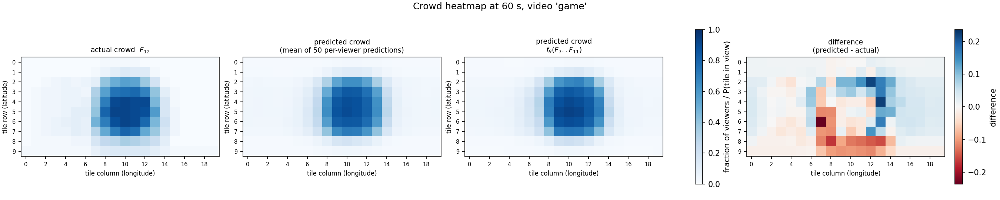
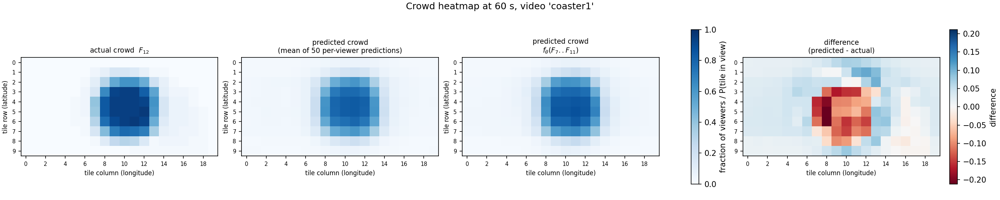
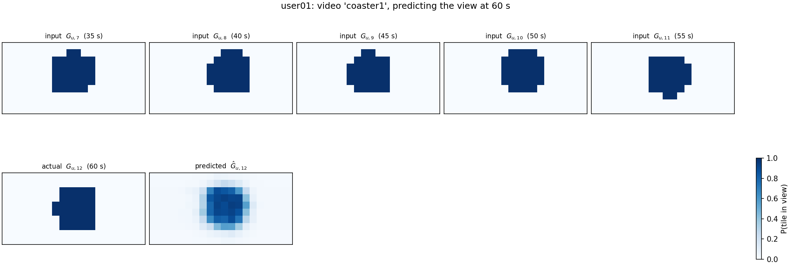

# FoV predictors for the five videos

The FoV predictor in `README.md` (section 1) was first trained on one video, coaster1. Viewers look around differently in
every video, so a predictor trained on one video cannot be assumed to work on another. This folder therefore holds **one
predictor per video**. Each has its own weights, trained only on that video's viewers, and is then frozen (its weights
are set and saved to a `.pt` file).

Ten videos were trained first. The five with the lowest error were kept (section 5) and the others removed.

The network, its input and output, the training recipe and the random seed are the same for every video, so the
CVAE-GAN can load any of them the same way. Any difference in the results below comes from the viewers of that video.

## Folder layout

```
predictor/
├── make_video_predictors.py      makes one copy of the coaster1 notebook per video and runs it
├── cv_predictors.py              held-out RMSE of every predictor (5-fold over viewers) and the figure below
├── summary_rmse.csv              the RMSE values of section 3, one row per video
├── fov_videos_summary.md         this file
├── figures/rmse_by_video.png     the figure in section 3
└── <video>/                      coaster1, coaster2, game, pacman, sport
    ├── fov_predictor_<video>.ipynb     the coaster1 notebook with only the video changed, run from this folder
    ├── predictor_weights_<video>.pt    the frozen predictor of this video
    └── figures/                        the 5 figures of the notebook
```

To build, train and score all five predictors again:

```bash
source .venv/bin/activate          # Windows: .venv\Scripts\activate
pip install nbformat nbconvert
python predictor/make_video_predictors.py --run                       # all videos
python predictor/make_video_predictors.py --run --videos pacman sport # only some
python predictor/cv_predictors.py                                     # held-out RMSE -> summary_rmse.csv
```

Every video has its own folder; there is no notebook outside them. `coaster1/fov_predictor_coaster1.ipynb` is the
template. The script finds every video folder under `dataset/360dataset/sensory/tile/` and reads the filename prefix from
the files inside it (folder `coaster1/`, for example, holds `coaster_userNN_tile.csv`). In each copy of the coaster1
notebook it changes only `Cfg.video`, `Cfg.folder`, `Cfg.prefix`, the data path and the name of the weights file. It then
runs the notebook and writes `summary_rmse.csv`.

## 1. The data

Every video has the same shape of data:

| | |
|---|---|
| videos | coaster1, coaster2, game, pacman, sport |
| viewers per video | 50 (`user01` – `user50`) |
| length | 60 s at 30 fps, 1800 frames |
| tiles | a 20 × 10 grid (longitude × latitude), tiles numbered 0 – 199 row by row |
| one CSV per viewer | frame number, then the numbers of the tiles in the viewer's field of view |

Each viewer's CSV is turned into a 10 × 20 map with a 1 on every tile in view. The maps sampled once every 5 s,
$G_{u,1}, \dots, G_{u,12}$, are what the predictor is scored on and what the CVAE-GAN uses.

## 2. How every predictor is trained

Every number below is identical for all five videos.

| | |
|---|---|
| input → output | the last five maps $G_{u,k-5}, \dots, G_{u,k-1}$, 5 s apart → the map 5 s later, $\hat G_{u,k}$, as a probability per tile |
| network | 3×3 convolution (16 filters) → 3×3 convolution with dilation 2 (16 filters) → 1×1 head with sigmoid; **3,073 weights** |
| padding | wraps around in longitude (the 360° seam), zero in latitude |
| training pairs | the same input and target, but a pair starts **every 5 frames** instead of only at 5, 10, …, 60 s: 210 per viewer, 10,500 per video |
| loss | binary cross-entropy between $\hat G_{u,k}$ and $G_{u,k}$ |
| optimiser | Adam, learning rate $10^{-3}$, batches of 256, 20 passes over the pairs |
| start | Glorot-uniform weights, head bias set to the log-odds of the video's average tile occupancy |
| seed, device | seed 0, CPU, deterministic algorithms: a rerun gives the same weights |

**Why this recipe.** The first version took 494 plain gradient-descent steps on the 7 pairs per viewer at the 5-s
sample times. Scored on held-out viewers (section 3), Adam on the denser pairs gave a lower error for every video. The
choice was made by 5-fold cross-validation over viewers. Binary cross-entropy, squared error and 60 passes instead of 20
all came within 0.001 of each other, so the error is limited by the network, not by the training. The network, its input
and its output were deliberately not changed, because the CVAE-GAN depends on them.

After training, every weight gets `requires_grad = False`. The checkpoint stores the weights together with the settings
(`cfg`), the base rate, the viewer lists and the final RMSE, with the same keys as before. A predictor is loaded with the
`load_pretrained_predictor` function in the last section of each notebook.

## 3. Results

Each notebook trains on all 50 viewers, so the RMSE it prints is a fit to its own training data. The honest scores
come from `cv_predictors.py`. The 50 viewers are split into 5 folds (viewer $i$ goes to fold $i \bmod 5$, as in the
CVAE-GAN notebooks). A predictor is trained on 40 viewers with the recipe above and scored on the other 10, at the 7
target times $k = 6, \dots, 12$, and this is repeated for every fold. Two errors are measured:

- **single viewer:** the predictor on one held-out viewer's last five maps, against that viewer's actual map;
- **crowd:** the predictor on the held-out 10 viewers' averaged maps, against the actual averaged map. This is the
  **crowd frame the CVAE-GAN takes as input**.

Both are RMSE per tile on the 0–1 scale, mean ± standard deviation over the 5 folds. Lower is better.

| video | **crowd RMSE** | crowd: repeat the last map | single-viewer RMSE | single: repeat the last map |
|---|---|---|---|---|
| game | **0.0970 ± 0.0087** | 0.1153 | 0.2552 ± 0.0108 | 0.3277 |
| coaster1 | **0.0997 ± 0.0084** | 0.1207 | 0.2546 ± 0.0191 | 0.3175 |
| coaster2 | **0.1030 ± 0.0028** | 0.1150 | 0.2554 ± 0.0063 | 0.3112 |
| pacman | **0.1215 ± 0.0073** | 0.1567 | 0.2310 ± 0.0154 | 0.3067 |
| sport | **0.1224 ± 0.0095** | 0.1879 | 0.2418 ± 0.0142 | 0.3214 |


Held-out RMSE of each video's predictor (blue, mean ± std over 5 folds) next to repeating the last map (grey), for single
viewers (left) and crowds (right). Videos are sorted by crowd RMSE.

**Fit on the training viewers** (printed by each notebook; all 50 viewers are training data here):

| video | new: all 50 | new: test group | before: all 50 | repeat the last map | average tile occupancy |
|---|---|---|---|---|---|
| pacman | 0.2264 | 0.2344 | 0.2479 | 0.3073 | 0.3661 |
| sport | 0.2380 | 0.2499 | 0.2602 | 0.3222 | 0.3677 |
| coaster2 | 0.2511 | 0.2505 | 0.2640 | 0.3114 | 0.3673 |
| game | 0.2512 | 0.2297 | 0.2781 | 0.3279 | 0.3679 |
| coaster1 | 0.2523 | 0.2375 | 0.2729 | 0.3183 | 0.3716 |

## 4. What the predictors look like

Each notebook saves the same five figures in `<video>/figures/`: one viewer's 12 FoV maps, all 50 viewers at 60 s
(actual and predicted), one viewer's prediction, and the crowd heatmap.

### game (lowest crowd RMSE)



The crowd at 60 s: the actual share of viewers looking at each tile, the mean of the 50 per-viewer predictions, the
predictor applied to the crowd frames, and the difference between the prediction and the actual crowd.

### coaster1 (the predictor used by the CVAE-GAN)





One viewer of the test group: the five input maps (top row), and the actual and predicted map 5 s later (bottom row).

## 5. Conclusion

1. **Which videos.** Of the ten videos first trained, these five had the lowest predictor error. The other five
   (landscape, panel, ride, diving, drive) were removed. Ride's predictor did worse than repeating the last map, and
   diving's learned almost nothing beyond the base rate.
2. **On crowd frames, the input of the CVAE-GAN, the predictors reach an RMSE of 0.10–0.12** on crowds they never
   saw, below repeating the last frame for every video.
3. **For a single viewer the error is 0.23–0.26.** Every training recipe tried gave the same result, so this is the
   limit of this 3,073-weight network predicting one person's view 5 s ahead. Going lower would need a larger network or a
   different input, and both would change what the CVAE-GAN receives.
4. **Which file to use.** For video `<video>`, load `predictor/<video>/predictor_weights_<video>.pt`.

The CVAE-GAN notebooks in `vae/` use the coaster1 predictor, `predictor/coaster1/predictor_weights_coaster1.pt`, and read
the tile CSVs from `dataset/360dataset/sensory/tile/coaster1/`. Their results were produced with the earlier coaster1
weights; see the note in `README.md` section 1.
