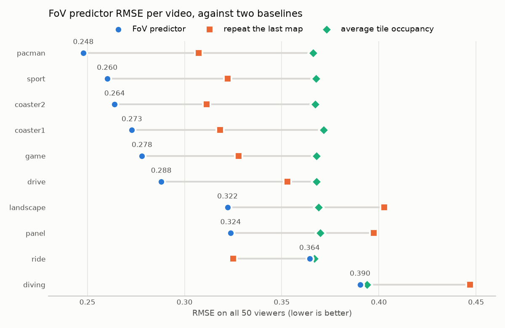
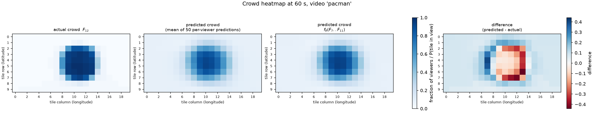
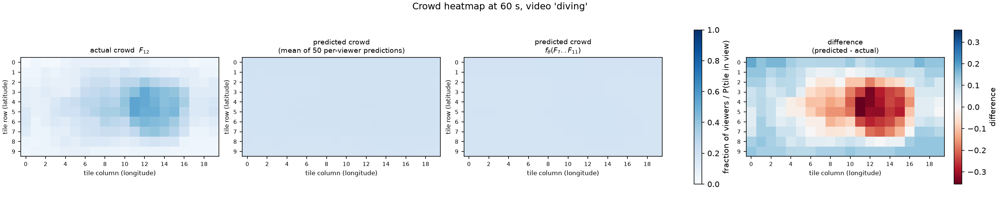
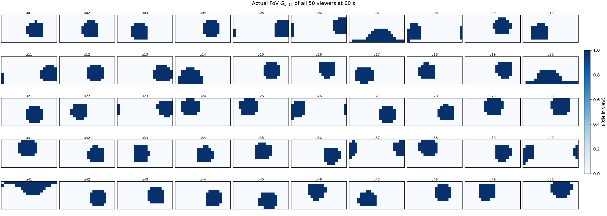

# FoV predictors for all ten videos

The FoV predictor in `README.md` (section 1) was trained on one video, coaster1. Viewers look around differently in
every video, so a predictor trained on one video cannot be assumed to work on another. This folder therefore holds **one
predictor per video**, ten in all. Each is trained in exactly the same way as the coaster1 predictor and then frozen
(its weights are set and saved to a `.pt` file).

The model, the hyper-parameters and the random seed are the same for every video. Any difference in the results
below comes from the viewers of that video, not from the training.

## Folder layout

```
predictor/
├── make_video_predictors.py      makes one copy of the coaster1 notebook per video and runs it
├── summary_rmse.csv              the RMSE values of section 3, one row per video
├── fov_videos_summary.md         this file
├── figures/rmse_by_video.png     the figure in section 3
└── <video>/                      coaster1, coaster2, diving, drive, game, landscape, pacman, panel, ride, sport
    ├── fov_predictor_<video>.ipynb     the coaster1 notebook with only the video changed, run from this folder
    ├── predictor_weights_<video>.pt    the frozen predictor of this video
    └── figures/                        the 5 figures of the notebook
```

To build and train all ten predictors again:

```bash
source .venv/bin/activate
pip install nbformat nbconvert
python predictor/make_video_predictors.py --run                       # all videos
python predictor/make_video_predictors.py --run --videos diving ride  # only some
```

Every video has its own folder; there is no notebook outside them. `coaster1/fov_predictor_coaster1.ipynb` is the
template: the script finds every video folder under `dataset/360dataset/sensory/tile/`, reads the filename prefix from
the files inside it (folder `coaster1/`, for example, holds `coaster_userNN_tile.csv`), and in each copy of the coaster1
notebook changes only `Cfg.video`, `Cfg.folder`, `Cfg.prefix`, the data path and the name of the weights file. It then runs the
notebook and writes `summary_rmse.csv`.

## 1. The data

Every video has the same shape of data:

| | |
|---|---|
| videos | coaster1, coaster2, diving, drive, game, landscape, pacman, panel, ride, sport |
| viewers per video | 50 (`user01` – `user50`) |
| length | 60 s at 30 fps, 1800 frames |
| tiles | a 20 × 10 grid (longitude × latitude), tiles numbered 0 – 199 row by row |
| one CSV per viewer | frame number, then the numbers of the tiles in the viewer's field of view |

As for coaster1, each viewer's CSV is turned into a 10 × 20 map with a 1 on every tile in view, sampled once every 5 s.
This gives 12 maps $G_{u,1}, \dots, G_{u,12}$ per viewer.

## 2. How every predictor is trained

This is the same procedure as in `README.md` section 1. Every number below is identical for all ten videos.

| | |
|---|---|
| input → output | the last five maps $G_{u,k-5}, \dots, G_{u,k-1}$ → the map 5 s later, $\hat G_{u,k}$, as a probability per tile |
| network | 3×3 convolution (16 filters) → 3×3 convolution with dilation 2 (16 filters) → 1×1 head with sigmoid; **3,073 weights** |
| padding | wraps around in longitude (the 360° seam), zero in latitude |
| pairs | 7 per viewer ($k = 6, \dots, 12$), 350 per video |
| one epoch | 10 of the 50 viewers drawn at random, their 70 pairs, **one** plain gradient-descent step |
| epochs | 494 (48 h of video at 350 s per epoch) |
| loss | $J(\theta) = \lVert \hat G_{u,k} - G_{u,k} \rVert_2^2$, averaged over the epoch's 70 pairs |
| learning rate | $\eta_e = a/(b+e)$ with $a = 0.1$, $b = 0.5$ |
| start | Glorot-uniform weights, head bias set to the log-odds of the video's average tile occupancy |
| test group | a 10-viewer group drawn first and never used as an epoch's group |
| seed, device | seed 0, CPU, deterministic algorithms: a rerun gives the same weights |

The test group is a group of 10 that no epoch uses as a whole, but its viewers do appear in other epochs' groups. The
"test group" RMSE is therefore not a score on unseen viewers. Of the two scores, the RMSE on all 50 viewers is the main
one.

After training, every weight gets `requires_grad = False`. The checkpoint stores the weights together with the settings
(`cfg`), the base rate, the viewer lists and the final RMSE. A predictor is loaded with the
`load_pretrained_predictor` function in the last section of each notebook.

## 3. Results

The RMSE is the error per tile between the predicted map $\hat G_{u,k}$ and the actual map $G_{u,k}$, on the 0–1 scale,
over all pairs. Lower is better. Two naive baselines are scored on the same pairs:

- **repeat the last map:** predict $G_{u,k-1}$ again;
- **average tile occupancy:** predict the same value, the video's base rate, on every tile.

| video | FoV predictor, all 50 | FoV predictor, test group | repeat the last map | average tile occupancy | base rate |
|---|---|---|---|---|---|
| pacman | **0.2479** | 0.2595 | 0.3073 | 0.3661 | 0.160 |
| sport | **0.2602** | 0.2720 | 0.3222 | 0.3677 | 0.161 |
| coaster2 | **0.2640** | 0.2616 | 0.3114 | 0.3673 | 0.161 |
| coaster1 | **0.2729** | 0.2601 | 0.3183 | 0.3716 | 0.165 |
| game | **0.2781** | 0.2629 | 0.3279 | 0.3679 | 0.161 |
| drive | **0.2880** | 0.2883 | 0.3529 | 0.3678 | 0.161 |
| landscape | **0.3221** | 0.3143 | 0.4028 | 0.3689 | 0.162 |
| panel | **0.3237** | 0.3266 | 0.3973 | 0.3699 | 0.164 |
| ride | 0.3643 | 0.3646 | **0.3249** | 0.3668 | 0.160 |
| diving | **0.3903** | 0.3903 | 0.4469 | 0.3939 | 0.192 |

(Baselines on all 50 viewers. The bold value is the lowest RMSE in each row. `summary_rmse.csv` also has the baselines
on the test group.)



The RMSE of each video's predictor (blue circle) next to the two baselines, on all 50 viewers. The videos are sorted
from the lowest predictor RMSE (top) to the highest.

The coaster1 predictor reproduces the earlier result exactly (0.2729 and 0.2601). Training is deterministic, so this
also checks that the new folder layout loads the same data.

## 4. What the predictors look like

Each notebook saves the same five figures in `<video>/figures/`: one viewer's 12 FoV maps, all 50 viewers at 60 s
(actual and predicted), one viewer's prediction, and the crowd heatmap. Three videos are shown here, the best, a typical
one and the hardest.

### pacman (lowest RMSE)



The crowd at 60 s: the actual share of viewers looking at each tile, the mean of the 50 per-viewer predictions, the
predictor applied to the crowd frames, and the difference between the prediction and the actual crowd.

### coaster1 (the original video)


One viewer of the test group: the five input maps (top row), and the actual and predicted map 5 s later (bottom row).

### diving (highest RMSE)





The actual FoV of all 50 viewers of diving at 60 s. Compare it with the same figure for another video, for example
`coaster1/figures/all_users_actual.png`.

## 5. Conclusion

1. **Eight of the ten predictors beat both baselines clearly.** On pacman, sport, coaster2, coaster1, game, drive,
   landscape and panel the predictor's RMSE is 12 – 32 % below the average tile occupancy and 14 – 20 % below repeating
   the last map.
2. **On ride the predictor is worse than repeating the last map** (0.3643 against 0.3249), and only just below the
   average occupancy (0.3668). Viewers of ride seem to move their view little from one 5 s step to the next, so the
   last map is already a good guess. The predictor's spread-out probabilities then cost more than they gain. This is
   our reading of the numbers, not a tested explanation.
3. **On diving the predictor learns almost nothing beyond the base rate**: 0.3903 against 0.3939 for the average
   occupancy. Diving is also the only video with a clearly higher base rate (0.192, against about 0.16 for the
   others), so its viewers see more tiles at once.
4. **Which file to use.** For video `<video>`, load `predictor/<video>/predictor_weights_<video>.pt`. For ride and
   diving, check whether the predictor is good enough for the purpose, or compare against the baselines above.

The CVAE-GAN notebooks in `vae/` use the coaster1 predictor, `predictor/coaster1/predictor_weights_coaster1.pt`, and read
the tile CSVs from `dataset/360dataset/sensory/tile/coaster1/`.
